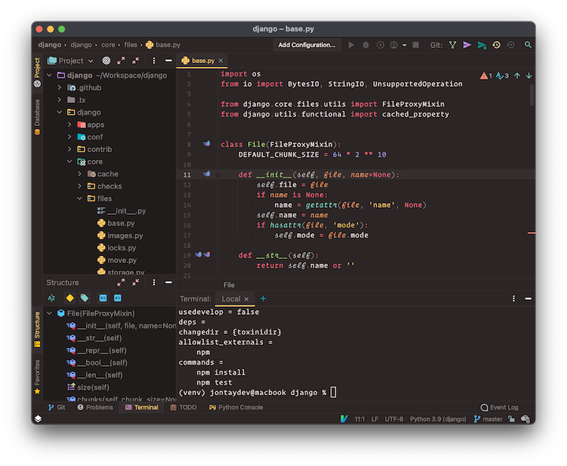

# Monokai Pro (Filter Ristretto) Colors

The **Monokai Pro (Filter Ristretto)** theme for IntelliJ IDEA, Rider, PyCharm, WebStorm, and any IDE based on IntelliJ Platform. It's the theme I work with daily, and I share it with no restrictions: **it is not behind any paywall**.



## Included variants

- **Monokai Pro (Filter Ristretto) - Islands**: adapts backgrounds, tabs, and separators to JetBrains' new **Islands UI**.
- **Monokai Pro (Filter Ristretto) - Classic**: keeps the classic Darcula-based look.

Both include the editor syntax color scheme in **Settings → Editor → Color Scheme → Monokai Pro (Filter Ristretto)**.

## What it does NOT do

- Ships no icons and replaces none, and does not change any icon palette: your file icon plugin keeps working alongside it without conflicts.
- Installs no keymaps, actions, or other extensions.

## Compatibility

- IntelliJ Platform **2025.2.3** or later (`sinceBuild = 252.26830`).
- Works in every IDE based on the platform (only depends on `com.intellij.modules.platform`).
- The Islands variant requires an IDE build that ships the Islands UI (2025.3+).

## Install

JDK 21 is required to build. Generate the plugin:

```powershell
.\gradlew.bat buildPlugin
```

Install `build/distributions/monokai-pro-ristretto-colors-1.0.0.zip` via **Settings → Plugins → ⚙ → Install Plugin from Disk…**, then pick your preferred variant in **Settings → Appearance & Behavior → Appearance & UI → Theme**.

## Project structure

```
src/main/resources/monokai-ristretto.theme.json         Islands theme
src/main/resources/monokai-ristretto-classic.theme.json Classic theme (Darcula)
src/main/resources/schemes/ristretto.xml                Editor color scheme
src/main/resources/META-INF/plugin.xml                  Plugin registration
images                                                  Theme screenshot
```

## Credits

Plugin by **Angel Mario Roque Suárez** · [github.com/Angel-Mario](https://github.com/Angel-Mario).

The palette and the JetBrains adaptation are based on the community project [Subtheme Monokai Pro](https://github.com/espositocode/monokai-pro). Monokai Pro is a trademark of its owners; this is an unofficial Filter Ristretto adaptation with no affiliation to Subtheme. MIT license (`LICENSE`).
